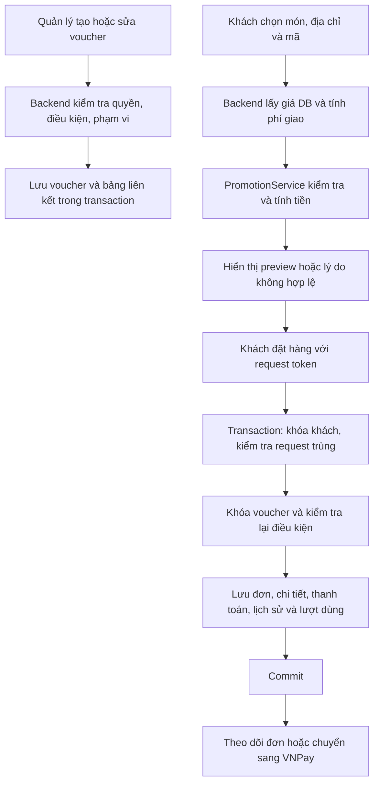

# FoodApp-NL0069

## Voucher / khuyến mãi — cập nhật 20/10/2026

Triển khai trên nhánh `feature/nhat-vendor-integration`. Web ASP.NET Core và API cho MAUI dùng chung nghiệp vụ voucher. Không commit, push, merge hoặc thay connection string chính trong đợt cập nhật này.

**Trạng thái bàn giao:** đã triển khai source và kiểm tra build Web/MAUI Windows; 26 kiểm thử nghiệp vụ pass. Migration voucher đã chạy thành công hai lần liên tiếp trên `QuanLyDichVuAnUong_MigrationTest`. Chưa xác nhận end-to-end và các integration test đặt hàng/concurrency/phân quyền: database thử còn thiếu schema checkout ngoài phạm vi voucher, không có món ăn và khách hàng mẫu. Không ghi dữ liệu lên `QuanLyDichVuAnUong`.

### 13 chức năng

“Hoàn thành ở source” bên dưới không có nghĩa integration test đã pass. Tất cả chức năng cần kiểm chứng thực tế trên database có đủ schema ứng dụng trước khi triển khai chính thức.

| # | Chức năng | Trạng thái | Xử lý |
|---|---|---|---|
| 1 | Voucher theo gian hàng | Hoàn thành ở source | Chủ sở hữu lấy từ tài khoản; backend chặn ID của quán khác |
| 2 | Voucher toàn hệ thống | Hoàn thành ở source | Admin quản lý voucher có `MaGianHang = null`; chỉ SuperAdmin được ghi |
| 3 | Giảm phần trăm | Hoàn thành ở source | 1–100%, tính trên món đủ điều kiện, có trần giảm |
| 4 | Giảm VNĐ cố định | Hoàn thành ở source | Số tiền > 0; không vượt giá trị món đủ điều kiện |
| 5 | Giảm phí vận chuyển | Hoàn thành ở source | Giảm tối đa phí giao; nhập 0 = miễn phí giao |
| 6 | Đơn tối thiểu | Hoàn thành ở source | Tổng tiền món trước giảm, không gồm phí giao |
| 7 | Giới hạn tổng lượt | Hoàn thành ở source | NULL = không giới hạn; kiểm tra lại dưới khóa SQL khi đặt đơn |
| 8 | Mỗi khách một lần | Hoàn thành ở source | Đối chiếu lịch sử bằng MaKH, không tin email/lịch sử của client |
| 9 | Thời gian bắt đầu/kết thúc | Hoàn thành ở source | Kiểm tra giờ Việt Nam; hai mốc được tính bao gồm |
| 10 | Phạm vi món ăn | Hoàn thành ở source | Chọn danh sách; chỉ phần giá trị món phù hợp được giảm |
| 11 | Phạm vi danh mục | Hoàn thành ở source | Món khớp danh mục HOẶC danh sách món; không cộng hai lần |
| 12 | Phạm vi gian hàng | Hoàn thành ở source | Admin chọn tập gian hàng; gian hàng không tự gán chủ sở hữu/phạm vi khác |
| 13 | Checkout Web/Mobile | Còn phần kiểm chứng end-to-end | Đã nối service chung, preview và transaction đặt đơn; cần database checkout đầy đủ để xác nhận toàn luồng |

### Chức năng thêm, sửa, bỏ

- **Thêm:** `PromotionService` tính giá từ database, trả trạng thái, mã lỗi tiếng Việt, tổng tiền món, giá trị đủ điều kiện, phí giao, tiền giảm, tổng cuối; `PromotionManagementService` dùng chung kiểm tra/cập nhật voucher và phạm vi.
- **Thêm:** API preview `POST /api/mobile/khuyen-mai/kiem-tra`; API quản lý `/api/mobile/promotions/{vendor|admin}` gồm danh sách, chi tiết, lựa chọn phạm vi, tạo, sửa, bật/tắt.
- **Thêm:** trình sửa MAUI `PromotionEditorPage` với checkbox chọn món/danh mục/gian hàng, thời gian, giới hạn lượt, đơn tối thiểu, trần %, trạng thái và mỗi khách một lần. Cả đường dẫn editor cũ cũng chuyển sang editor này khi online/đã đăng nhập API.
- **Sửa:** form gian hàng Web lưu đầy đủ các trường nâng cao; form Admin và gian hàng dùng chung danh sách multi-select thay nhập ID thủ công. Hiển thị giới hạn lượt/phạm vi, miễn phí giao, chưa bắt đầu, hết lượt trên danh sách.
- **Sửa:** Web checkout cập nhật mã và địa chỉ giữa hai form, tính lại voucher khi đổi địa chỉ; không dùng phí do trình duyệt gửi làm căn cứ.
- **Sửa:** MAUI online gọi máy chủ khi nhập/chọn mã, đổi địa chỉ và trước khi đặt hàng. Mã sai trả lỗi, không tự bỏ mã để đặt đơn. Mất mạng khi đã có token không chuyển checkout sang đặt đơn demo.
- **Sửa:** Mobile lưu `TienGiam`, lịch sử voucher, lượt dùng và request token; lấy giá món đã lưu trong chi tiết đơn khi hiển thị lịch sử, tránh thay đổi tổng cũ khi giá thực đơn đổi.
- **Sửa:** phí giao của các API checkout dùng cùng cấu hình `Giao.PhiMoiKm`/`Giao.PhiMacDinh` với Web. MAUI online chỉ hiện Tiền mặt/VNPay và mở URL thanh toán trả về. Request trùng Mobile trả lại đơn đã tạo, kèm URL VNPay nếu còn cần thanh toán.
- **Bỏ/thay thế:** hàm tính khuyến mãi riêng của Mobile API và đoạn tính riêng trong Customer API; thay bằng service chung. Web giữ wrapper `TinhKhuyenMaiAsync` để dùng service chung.
- **Bỏ ở luồng online:** quản lý voucher chỉ lưu local và tự hoàn lượt khi hủy. Nút ngừng voucher gọi backend để tắt, giữ lịch sử; không có xóa vật lý voucher đã dùng. Chế độ demo ngoại tuyến không đăng nhập vẫn giữ dữ liệu mô phỏng riêng, không phải hệ thống voucher thật.
- Không xóa bảng/cột cũ, không sửa các chức năng đăng ký/quản trị gian hàng đang có thay đổi chưa commit trước đợt này.

### Quy tắc tính tiền

1. Client chỉ gửi mã voucher, món, số lượng, địa chỉ. Backend lấy giá món/tùy chọn từ database và xác định phí giao trước khi tính giảm.
2. Chuẩn hóa mã bằng trim và uppercase; một đơn chỉ áp dụng một mã.
3. Kiểm tra tồn tại, kích hoạt, thời gian, chủ sở hữu/phạm vi gian hàng, tổng món tối thiểu, tổng lượt, lịch sử mỗi khách một lần, món/danh mục phù hợp.
4. Không chọn món và danh mục nghĩa là mọi món. Nếu có chọn, lấy các dòng khớp **món HOẶC danh mục**. Giảm % và tiền cố định chỉ trên phần này; tổng tối thiểu vẫn xét toàn bộ tiền món.
5. Giảm % làm tròn VNĐ bằng `Math.Round`, rồi áp trần và giới hạn phần món đủ điều kiện. Voucher vận chuyển chỉ trừ phí giao; `SoTienGiam = 0` hoặc NULL cũ nghĩa là miễn phí giao. Không chuyển phần dư sang giảm món.
6. Tổng cuối = tổng món + phí giao − tiền giảm; không âm. Kết quả preview có thể thay đổi nếu điều kiện hoặc dữ liệu thay đổi trước lúc đặt; backend luôn kiểm tra lại.

Mã lỗi chính: `NOT_FOUND`, `DISABLED`, `NOT_STARTED`, `EXPIRED`, `WRONG_STORE`, `MINIMUM`, `EXHAUSTED`, `ALREADY_USED`, `NO_ELIGIBLE_ITEMS`, `INVALID_CONFIG`, `INVALID_CART`, `EMPTY_CART`. API quote trả `hopLe`, `code`, `thongDiep`, `tongTienMon`, `giaTriHopLe`, `phiGiaoHang`, `giamGia`, `tongTien`, `loaiGiam`. API đặt hàng trả HTTP 400 khi mã không hợp lệ.

### Luồng hoạt động



Luồng chung được sử dụng tại `CustomerCartController.DatHang`, `MobileApiController.PlaceOrder`, `CustomerApiController.PlaceOrder`. API cũ `/api/customer/orders` (theo route controller hiện có) cũng yêu cầu `MaYeuCauDat`, dài tối đa 40 ký tự. MAUI tạo một GUID cho mỗi phiên checkout và giữ lại khi retry. Web đưa token vào cả form áp mã và đặt hàng.

### Transaction, concurrency và chính sách hủy/thanh toán

- `sp_getapplock` với owner Transaction khóa theo `checkout:customer:{MaKH}` trước khi kiểm tra token. Hai request của cùng khách được xử lý tuần tự; cùng token trả lại đơn đã tồn tại.
- Đọc voucher với `UPDLOCK,HOLDLOCK` trong transaction. Khách thứ hai tranh lượt cuối chỉ đọc bộ đếm sau khi transaction trước kết thúc. Khóa này cũng phối hợp với cập nhật voucher từ màn quản lý.
- Kiểm tra voucher, tạo đơn, chi tiết, thanh toán ban đầu, tăng bộ đếm và thêm `KhuyenMaiKhachDung` cùng transaction. Lỗi trước commit làm rollback; gọi cổng thanh toán sau commit.
- Unique index mã voucher, token đặt hàng và lịch sử theo `MaDonHang` là lớp bảo vệ bổ sung. Không có unique toàn cục `(MaKhuyenMai, MaKH)` vì voucher nhiều lần vẫn phải hoạt động; điều kiện mỗi khách một lần được bảo vệ bằng khóa và lịch sử.
- **Chính sách:** voucher được tiêu thụ khi đơn commit. Thanh toán thất bại hoặc đơn hủy **giữ lượt và lịch sử**, không tự hoàn. Luồng thanh toán hiện có cho phép retry/đổi phương thức; giữ lượt tránh vừa hoàn vừa tiếp tục dùng giảm giá trên đơn cũ. Đây là lựa chọn bảo thủ, không triển khai cơ chế hoàn lượt tự động trong bản này. Lỗi transaction trước commit không mất lượt.
- Bộ đếm không nhận từ form/DTO quản lý. Giảm giới hạn xuống dưới lượt đã dùng bị từ chối.

### Phân quyền và API quản lý

| Endpoint | Chức năng |
|---|---|
| `GET /api/mobile/promotions/vendor` | Voucher thuộc gian hàng của tài khoản JWT |
| `GET /api/mobile/promotions/admin` | Voucher hệ thống, không cho sửa voucher của gian hàng |
| `GET .../options` | Danh sách món/danh mục/gian hàng được phép chọn |
| `GET .../{id}` | Đọc form voucher trong phạm vi được phép |
| `POST ...` / `PUT .../{id}` | Tạo/sửa; không nhận quyền sở hữu hoặc bộ đếm từ client |
| `PUT .../{id}/status` | `{ "dangHoatDong": true/false }`; giữ lịch sử |

Gian hàng cần tài khoản hoạt động và hồ sơ đã duyệt. Admin ghi dữ liệu cần `SuperAdmin`, kiểm tra lại trong DB; không mở quyền cho `QuanLy`/`NhanVien`. Web giữ bộ lọc `ChiSuperAdminGhi`. Món/danh mục gửi bằng ID ngoài gian hàng bị từ chối ở service, kể cả bỏ qua giao diện.

### Migration database

Script: [`Database/NangCap_v16_Voucher.sql`](Database/NangCap_v16_Voucher.sql).

- Chặn trước khi ghi nếu `DB_NAME()` khác `QuanLyDichVuAnUong_MigrationTest`. Không có `USE` để âm thầm đổi database.
- Có transaction, `XACT_ABORT`, kiểm tra tồn tại, khóa ngoại, unique index, check constraint; lỗi rollback toàn bộ. Không DROP/reset dữ liệu.
- Thêm các cột voucher hiện đại và bảng `KhuyenMaiMonAn`, `KhuyenMaiDanhMuc`, `KhuyenMaiGianHang`, `KhuyenMaiKhachDung` khi thiếu; bổ sung token và tiền giảm của đơn.
- Chuyển phạm vi đơn cũ `MaMonAn`, `MaDanhMuc`, `MaGianHangApDung` sang bảng nối **một lần** khi nâng từ schema chưa có `LoaiGiam`; chuyển cờ giảm vận chuyển cũ, giữ nguyên các cột cũ. Chạy lại không khôi phục phạm vi cũ đã bị sửa sau nâng cấp.
- Kiểm tra mã trùng sau chuẩn hóa; gặp dữ liệu xung đột thì dừng, không xóa bản ghi. Thu gọn `MaCode` kiểu MAX thành nvarchar(50) để tạo index chỉ khi không có mã dài hơn 50.
- Bổ sung lịch sử từ đơn đã áp mã (kể cả đơn hủy theo chính sách giữ lượt), tăng bộ đếm tối thiểu bằng lịch sử, không giảm bộ đếm cũ. Không tự suy đoán lại tiền giảm của đơn lịch sử thiếu số liệu.
- Giữ nguyên các bảng ngoài phạm vi như `CauHinhGianHang`, `ChienDichQuangCao`, `NhatKyTrangThaiDon`.

Lệnh kiểm tra trên bản thử nghiệm:

```powershell
sqlcmd -S '(localdb)\MSSQLLocalDB' -d QuanLyDichVuAnUong_MigrationTest -E -Q 'SELECT DB_NAME()'
sqlcmd -S '(localdb)\MSSQLLocalDB' -d QuanLyDichVuAnUong_MigrationTest -E -b -i Database/NangCap_v16_Voucher.sql
```

**Kết quả thực tế:** đã xác nhận đúng database, chạy migration thành công và chạy lại thành công. Lần thử trước đó thiếu SET QUOTED_IDENTIFIER đã rollback; script hiện tại đã bổ sung đầy đủ SET options cho filtered index. Không chạy `01_TaoMoi_Full.sql`, không chạy bất kỳ migration ghi nào trên database chính.

**Giới hạn schema hiện tại:** bản MigrationTest không có món/khách, chưa có `TuyChonMon`, thiếu các cột checkout như `DonHang.MaXacNhanGiao`, `ThanhToan.DaDoiSoat`. Script voucher không tự nâng cấp toàn bộ các module còn thiếu. Cần chuẩn bị bản test có schema ứng dụng đầy đủ và dữ liệu hợp lệ trước khi nghiệm thu checkout; không đổi connection string chính để thử.

### Build và kiểm thử

```powershell
# Build chuẩn; nếu bản app đang chạy khóa bin, dùng thư mục output riêng bên dưới.
dotnet build Web/FoodServiceApp.Web/FoodServiceApp.Web.csproj
dotnet build Web/FoodServiceApp.Web/FoodServiceApp.Web.csproj -o .artifacts/web-voucher
dotnet build Mobile_FoodApp.Maui/FoodApp.Maui.csproj -f net8.0-windows10.0.19041.0 -o .artifacts/maui-voucher

# Bộ kiểm thử chạy bằng console runner, trả exit code khác 0 khi assertion thất bại.
dotnet build Tests/FoodServiceApp.VoucherTests/FoodServiceApp.VoucherTests.csproj -o .artifacts/voucher-tests
dotnet .artifacts/voucher-tests/FoodServiceApp.VoucherTests.dll

# Chỉ bật integration trên DB thử đã có đủ schema và fixture.
$env:VOUCHER_TEST_CONNECTION='Server=(localdb)\MSSQLLocalDB;Database=QuanLyDichVuAnUong_MigrationTest;Trusted_Connection=True;Encrypt=False;TrustServerCertificate=True'
dotnet .artifacts/voucher-tests/FoodServiceApp.VoucherTests.dll
```

Kết quả đã thực thi:

- Web: build output riêng thành công. Output `bin/Debug` mặc định bị tiến trình ứng dụng đang chạy khóa; không dừng ứng dụng của người dùng.
- MAUI Windows net8.0: build thành công. Còn cảnh báo CS8604 ở `ReviewPage.xaml.cs:118` ngoài phạm vi voucher. Chưa build Android/iOS và chưa kiểm thử giao diện trực tiếp trên thiết bị.
- 26 assertions nghiệp vụ: **PASS**, gồm %/tiền/ship/miễn ship, giới hạn, thời gian, trạng thái, phạm vi, một lần, không có mã, cap và giá trị biên.
- Đã gọi runner với kết nối MigrationTest: các bài tích hợp **SKIP rõ ràng** vì preflight schema/fixture không đạt. Không coi SKIP là PASS.
- Các test tích hợp đã viết: hai khách tranh lượt cuối; một khách hai token với mã một lần; trùng token trả một đơn và một lịch sử; lỗi sau SaveChanges trước commit rollback; Web/Mobile cùng dữ liệu DB; gian hàng sửa voucher ngoài phạm vi; Admin không đủ quyền. Test yêu cầu dữ liệu khách/món sẵn có, giữ fixture có nhãn TEST (voucher tắt/đơn hủy), không xóa dữ liệu và không chạy được trên database chính.
- Khi build test trong sandbox có cảnh báo NU1900 do không lấy được dữ liệu audit NuGet; đây không phải kết quả kiểm tra lỗ hổng thành công.

### Kiểm thử thủ công còn cần thực hiện

1. Trên bản test đủ schema, tạo một voucher % chỉ cho một món, một mã tiền theo danh mục, một mã miễn ship và một mã hệ thống giới hạn quán. So sánh cùng giỏ, địa chỉ, khách trên Web/MAUI.
2. Đổi giá món sau preview, đổi địa chỉ/phí, tắt mã/hết hạn/hết lượt trước khi đặt. Backend phải tính lại hoặc từ chối rõ ràng; không tạo đơn âm thầm bỏ mã.
3. Dùng hai phiên khách tranh voucher còn một lượt; gửi đồng thời cùng token; thử hai token với mã mỗi khách một lần. Kiểm tra một lịch sử/đơn, bộ đếm và tổng thanh toán trong DB.
4. Sửa ID voucher/món/danh mục trong request người bán; thử tài khoản Admin cấp thấp. Backend phải trả 403/404 hoặc lỗi phạm vi, không đổi dữ liệu.
5. Giả lập lỗi lưu chi tiết/thanh toán trước commit; xác nhận không có đơn lẻ, không tăng lượt. Thanh toán VNPay thất bại/hủy rồi retry không tăng lần nữa; đơn hủy giữ lượt theo chính sách đã mô tả.
6. Kiểm tra create/edit/bật/tắt online từ MAUI, quay lại danh sách tải dữ liệu server; ngắt mạng khi đã đăng nhập phải hiện lỗi, không báo lưu local thành công.

### File thuộc thay đổi voucher

**Web thêm:**

- `Web/FoodServiceApp.Web/Services/PromotionService.cs`
- `Web/FoodServiceApp.Web/Services/PromotionManagementService.cs`
- `Web/FoodServiceApp.Web/Controllers/Api/PromotionApiController.cs`
- `Web/FoodServiceApp.Web/Views/Shared/_PromotionScopes.cshtml`

**Web sửa:**

- `Controllers/KhuyenMaiController.cs`, `Controllers/AdminKhuyenMaiController.cs`, `Controllers/CustomerCartController.cs`
- `Controllers/Api/MobileApiController.cs`, `Controllers/Api/CustomerApiController.cs`
- `Data/AppDbContext.cs`, `Models/Dtos/Dtos.cs`
- `Views/KhuyenMai/Index.cshtml`, `Views/KhuyenMai/_Form.cshtml`
- `Views/AdminKhuyenMai/Index.cshtml`, `Views/AdminKhuyenMai/_FormAdmin.cshtml`
- `Views/CustomerCart/Checkout.cshtml`

Các đường dẫn rút gọn ở nhóm trên nằm trong `Web/FoodServiceApp.Web/`.

**MAUI thêm:** `Mobile_FoodApp.Maui/Views/PromotionEditorPage.cs`.

**MAUI sửa** (trong `Mobile_FoodApp.Maui/`):

- `Models/Models.cs`, `Services/DuLieuService.cs`, `Services/KhuyenMaiService.cs`
- `Views/PaymentPage.xaml.cs`
- `Views/VendorPromotionsPage.xaml`, `Views/VendorPromotionsPage.xaml.cs`, `Views/VendorPromotionEditPage.xaml.cs`
- `Views/AdminPromotionsPage.xaml`, `Views/AdminPromotionsPage.xaml.cs`, `Views/AdminPromotionEditPage.xaml.cs`

**SQL/test/tài liệu:** `Database/NangCap_v16_Voucher.sql`, `Tests/FoodServiceApp.VoucherTests/FoodServiceApp.VoucherTests.csproj`, `Tests/FoodServiceApp.VoucherTests/Program.cs`, `Tests/FoodServiceApp.VoucherTests/IntegrationTests.cs`, `README.md`.

Các thay đổi có sẵn trước tác vụ trong `AdminGianHangController.cs`, `AuthController.cs`, `Models/ViewModels/ViewModels.cs`, `Views/Auth/DangKy.cshtml`, `Views/Dashboard/ChoDuyet.cshtml` và script `NangCap_CSDL_DBCu_V0.sql` không thuộc thay đổi voucher này và được giữ nguyên.
